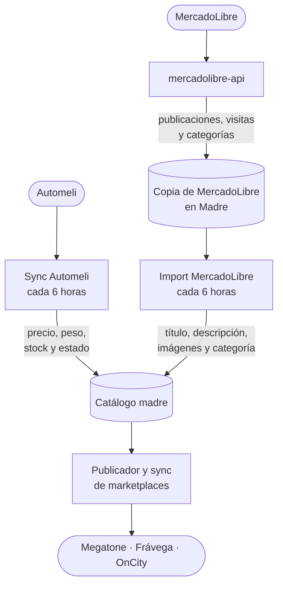

# Madre API

Microservicio interno de **Tienda Lo Quiero Acá** que guarda y sirve la base **Madre**: el catálogo maestro de productos y los datos que comparten los demás servicios.

Casi no tiene lógica de negocio propia: es el lugar donde los otros servicios **dejan y consultan** información. Por ejemplo, los pedidos de los marketplaces, el estado de cada publicación, las facturas de Xubio o las ventas que no se pudieron facturar. Lo que sí hace por su cuenta son dos sincronizaciones programadas que mantienen al día el catálogo desde Automeli y desde MercadoLibre.

## Qué guarda

| | |
|---|---|
| **Catálogo madre** | Un registro por SKU (casi siempre el ASIN de Amazon) con título, descripción, categoría, precio, stock, peso, imágenes y estado. |
| **Publicaciones en marketplaces** | Estado, precio y stock de cada SKU en Megatone, Frávega y OnCity, con su historial y las pausas manuales. |
| **Publicador** | Las corridas de publicación masiva y el resultado SKU por SKU. |
| **Marcas y categorías** | La equivalencia entre la marca y la categoría de MercadoLibre y las que exige cada marketplace. |
| **MercadoLibre** | Copia de las publicaciones propias, sus visitas y el árbol de categorías, con la analítica que se arma encima. |
| **Pedidos** | Los pedidos de los marketplaces normalizados, sin duplicados, y su avance hacia Flokzu. |
| **Facturación** | Copia de los comprobantes de Xubio y las ventas que no se pudieron facturar. |
| **Operación** | La planilla de control de cada venta, las publicaciones de la Central de Promociones, los impuestos por categoría y los usuarios del panel. |

## Cómo se arma el catálogo



Los dos procesos programados están explicados en [Procesos y estados](docs/procesos.md). Los pedidos y la facturación no pasan por el catálogo: `order-api` e `invoice.api` los guardan directamente. El significado de cada dato está en la [guía funcional](docs/funcional.md).

## Quién la usa

Los servicios que leen y escriben en Madre, según el código de cada uno:

| Servicio | Para qué |
|---|---|
| `order-api` | Registra los pedidos de los marketplaces y actualiza su avance (`/api/orders`). |
| `invoice.api` | Guarda la copia de los comprobantes de Xubio y las ventas que no pudo facturar (`/api/internal/xubio`, `/api/internal/invoice`). |
| `auth.api` | Guarda los usuarios y las sesiones del panel (`/api/internal/auth`). |
| `central-promotion-engine` | Consulta y carga las publicaciones de la Central de Promociones. |
| `spreadsheet.tlq` | Vuelca la planilla de control. |
| `products.api`, `mercadolibre-api`, `catalog-sync-api`, `madre-ai-matcher` | Catálogo, publicaciones de MercadoLibre, sincronización con marketplaces y equivalencia de marcas. |
| `front-tlq`, `panel-admin` | Paneles: analítica, favoritos, publicador e issues de facturación. |

## Ambientes

| Ambiente | URL base |
|---|---|
| Producción | `https://api.madre.loquieroaca.com` |
| Local | `http://localhost:3000` |

Todos los endpoints van bajo el prefijo `/api`. Además, el servicio publica:

| Herramienta | Ruta | Para qué |
|---|---|---|
| Documentación | `/docs` | Esta documentación, navegable y con buscador. |
| Swagger | `/api/docs` | Probar los endpoints desde el navegador. |

## Autenticación

Los grupos de endpoints internos piden este header:

| Header | Valor |
|---|---|
| `x-internal-api-key` | La clave interna del servicio (`INTERNAL_API_KEY`). |

Sin el header la respuesta es `401 Internal API key missing`, y con una clave incorrecta, `401 Invalid internal API key`. **No todos los endpoints lo piden**: la [referencia de la API](docs/api.md) indica en cada grupo si hace falta.

## Primer llamado

Consultar precio, stock, peso y estado de dos SKUs del catálogo:

```bash
curl -s -X POST "https://api.madre.loquieroaca.com/api/products/madre/status/bulk" \
  -H "Content-Type: application/json" \
  -d '{"skus":["B0953HLGJ3","B09GK544PP"]}'
```

```json
{
  "items": [
    { "sku": "B0953HLGJ3", "price": 150000, "amazonPrice": 89.99, "maxWeight": 1.2, "stock": 5, "status": "active" },
    { "sku": "B09GK544PP", "price": 0, "amazonPrice": null, "maxWeight": null, "stock": 0, "status": null }
  ],
  "total": 2
}
```

Un SKU que no está en el catálogo vuelve igual, con precio y stock en cero y estado `null`.

## Documentación

**Funcional**

| Documento | Qué explica |
|---|---|
| [Guía funcional](docs/funcional.md) | Qué guarda Madre en cada área, de dónde sale cada dato y qué reglas aplica. |
| [Procesos y estados](docs/procesos.md) | Las sincronizaciones automáticas del catálogo y el significado de cada estado: productos, publicaciones, publicador, pedidos y facturación. |

**API**

| Documento | Qué explica |
|---|---|
| [Referencia de la API](docs/api.md) | Todos los endpoints agrupados por área, con parámetros, valores por defecto, errores y ejemplos. |

**Técnico**

| Documento | Qué explica |
|---|---|
| [Arquitectura y configuración](docs/tecnico.md) | Capas del código, base de datos, Redis, integraciones, variables de entorno y limitaciones conocidas. |
| [Operación](docs/operacion.md) | Deploy, verificación y qué hacer ante los problemas más frecuentes. |

## Desarrollo local

Requisitos: Node.js 20 o superior, acceso a la base MySQL y un Redis con TLS (el servicio no arranca sin Redis).

```bash
npm install
cp .env.example .env    # completar las credenciales
npm run start:dev       # http://localhost:3000/api
```

```bash
npm test                # tests unitarios
npm run lint            # eslint con --fix
npx tsc --noEmit        # chequeo de tipos
```

Para ver la documentación como sitio, sin base de datos ni Redis:

```bash
npm run docs:preview    # http://localhost:4310/docs
```

## Stack

NestJS 11 · TypeScript · MySQL (TypeORM, con SQL directo) · Redis (ioredis) · Axios · Jest.
