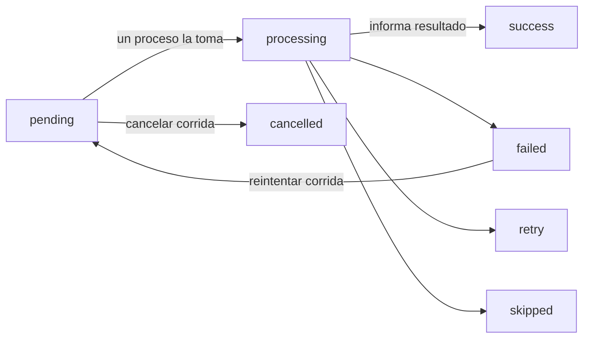

# Procesos y estados

Los procesos que Madre corre por su cuenta y el significado de cada estado que guarda. Para cada uno: qué es, quién lo cambia y qué hacer.

← [Volver al inicio](../README.md)

**Contenido**

- [Las sincronizaciones del catálogo](#las-sincronizaciones-del-catálogo)
  - [Sync Automeli](#sync-automeli)
  - [Import MercadoLibre](#import-mercadolibre)
  - [Cuando los dos se cruzan](#cuando-los-dos-se-cruzan)
  - [Completar pesos faltantes](#completar-pesos-faltantes)
- [Estados](#estados)
  - [Estado de un producto](#estado-de-un-producto)
  - [Estado de una publicación en un marketplace](#estado-de-una-publicación-en-un-marketplace)
  - [Corridas de sincronización de marketplaces](#corridas-de-sincronización-de-marketplaces)
  - [El publicador](#el-publicador)
  - [Pedidos](#pedidos)
  - [Sincronizaciones de comprobantes de Xubio](#sincronizaciones-de-comprobantes-de-xubio)
  - [Ventas que no se pudieron facturar](#ventas-que-no-se-pudieron-facturar)
  - [Carpetas de favoritos](#carpetas-de-favoritos)
  - [Sincronizaciones de MercadoLibre](#sincronizaciones-de-mercadolibre)

---

## Las sincronizaciones del catálogo

Dos procesos programados mantienen al día el [catálogo madre](funcional.md#el-catálogo-madre). Corren **a la misma hora**: 00:00, 06:00, 12:00 y 18:00, hora de Argentina.

| | Sync Automeli | Import MercadoLibre |
|---|---|---|
| Fuente | API de Automeli | Publicaciones de MercadoLibre guardadas en Madre |
| Dónde corre | Proceso aparte (*worker*) | Dentro del servicio principal |
| Qué productos toca | Solo publicaciones Clásicas (`gold_special`) | Todos los SKUs con publicación en MercadoLibre |
| Crea productos | No | Sí |
| Qué escribe | Precio, precio Amazon, peso, stock, estado, tiempo de envío, estados en MercadoLibre y Amazon | Título, descripción, categoría, imágenes, marca, precio, stock y estado |

Los dos comparten tres reglas:

- **Uno a la vez.** Si una corrida sigue en curso cuando llega la siguiente, la nueva no arranca. La marca de "en curso" se borra al terminar, o sola a las 4 horas si el proceso se cortó.
- **Solo lo que cambió.** Cada proceso recuerda una huella de la última versión de cada SKU y saltea los que siguen iguales. Si alguien modifica un producto por otra vía, el proceso no se entera hasta que cambie la fuente.
- **Sin aviso de errores.** Si una corrida falla, queda en los logs del servicio y nada más.

### Sync Automeli

1. Pide a Automeli todos los productos del vendedor, página por página.
2. Guarda **todas** las publicaciones en la foto de Automeli, sean del tipo que sean.
3. Se queda solo con las **Clásicas** (`gold_special`) y, de esas, con las que cambiaron en precio, precio Amazon, peso, stock, estado en Amazon o MercadoLibre, estado en Automeli o tiempo de fabricación.
4. Actualiza esos SKUs en el catálogo:

| Dato del catálogo | Sale de Automeli |
|---|---|
| Precio | Precio de venta en MercadoLibre |
| Precio Amazon | Precio total en Amazon |
| Peso | Peso máximo |
| Stock | Stock |
| Tiempo de envío | El primer número del tiempo de fabricación |
| Estado | Ver [Estado de un producto](#estado-de-un-producto) |
| Estado en MercadoLibre y en Amazon | Tal cual |

Un SKU que no existe en el catálogo **no se crea**.

**Si Automeli no responde.** Cada página se pide hasta 3 veces. Si las 3 fallan, la corrida corta ahí y termina como completada: lo que ya se procesó queda guardado y el resto espera a la próxima corrida.

### Import MercadoLibre

1. Recorre las publicaciones de MercadoLibre guardadas en Madre. Si un SKU tiene varias, toma la de **menor precio**.
2. Se queda con las que cambiaron en título, precio, stock o fotos.
3. Para cada una pide la descripción y la ruta completa de la categoría a `mercadolibre-api`, de a 20 a la vez. Si alguna de las dos no llega después de 3 intentos, sigue con ese dato vacío.
4. Crea o actualiza el SKU en el catálogo con título, descripción limpia, categoría, código de categoría, precio, stock, hasta 10 imágenes y marca.
5. **Deja el producto en estado `inactive`**, sea nuevo o existente.

### Cuando los dos se cruzan

Los dos procesos escriben el precio, el stock y el estado de los mismos productos, a la misma hora y sin esperarse entre ellos.

El efecto práctico: **un producto que el import de MercadoLibre actualiza queda `inactive`**, con el precio y el stock de MercadoLibre, hasta que algo cambie en Automeli para ese SKU y el sync de Automeli lo vuelva a escribir.

**Qué hacer** si un producto que debería estar activo figura como `inactive`: comparar su última actualización con su ficha de Automeli. Si Automeli lo da como disponible y con stock, hace falta que el sync de Automeli lo vuelva a escribir: ver [Operación](operacion.md).

### Completar pesos faltantes

Además de las corridas programadas, hay un proceso que se corre a mano: busca los productos del catálogo **sin peso**, recorre Automeli y les carga el peso máximo. No corre al mismo tiempo que el sync de Automeli.

---

## Estados

### Estado de un producto

| Estado | Significa | Quién lo pone |
|---|---|---|
| `active` | Se puede vender: Automeli lo tiene habilitado, Amazon lo da como **Disponible** y tiene stock. | Sync Automeli |
| `inactive` | Falta alguna de esas tres condiciones, o lo tocó el import de MercadoLibre. | Sync Automeli o Import MercadoLibre |

Ver [Cuando los dos se cruzan](#cuando-los-dos-se-cruzan).

### Estado de una publicación en un marketplace

| Estado | Significa | ¿Se puede editar? |
|---|---|---|
| `ACTIVE` | A la venta. | Sí |
| `PAUSED` | Pausada. | Sí |
| `PENDING` | En revisión del marketplace (Megatone). | Sí |
| `DELETED` | Eliminada del marketplace. | No |
| `ERROR` | Estado inválido. También lo recibe una publicación cargada a mano para un SKU que no estaba registrado en Megatone. | — |

Madre no controla los valores: guarda el estado que manda el proceso de sincronización.

### Corridas de sincronización de marketplaces

| Estado | Significa |
|---|---|
| `RUNNING` | En curso. |
| `SUCCESS` | Terminó bien. |
| `PARTIAL` | Terminó con algunas publicaciones fallidas. |
| `FAILED` | Falló. Se guarda el mensaje de error. |

### El publicador

**Tareas**

| Estado | Significa | Qué hacer |
|---|---|---|
| `pending` | Espera que un proceso la tome. | Nada. |
| `processing` | Un proceso la tomó y está publicando. | Si queda así mucho tiempo, el proceso se cortó: ver abajo. |
| `success` | Publicada. Tiene el ID de la publicación. | Nada. |
| `failed` | Falló. Tiene el error. | Revisar el error y reintentar la corrida. |
| `retry` | El proceso pidió reintentarla. | Ver abajo. |
| `skipped` | El proceso decidió no publicarla. | Nada. |
| `cancelled` | Se canceló la corrida antes de que alguien la tomara. | Nada. |

Hay dos casos en los que una tarea **no avanza sola**:

- **Una tarea en `processing` no se libera nunca.** Si el proceso que la tomó se corta, queda así.
- **Una tarea en `retry` no se vuelve a tomar.** Solo se toman las `pending`, y reintentar la corrida solo devuelve a `pending` las `failed`.

**Corridas.** Madre solo cambia una corrida a `cancelled`, al cancelarla. Sus contadores de avance se calculan en el momento, contando sus tareas por estado.

### Pedidos

| Estado | Significa |
|---|---|
| `PENDING` | Recién registrado. `order-api` todavía no lo envió a Flokzu. |
| `PROCESSED_FLOXU` | Ya está en Flokzu. |
| `COMPLETED` | Terminó todo el envío a los sistemas. |
| `CANCELLED` | El pedido se canceló. |
| `FAILED` | Falló el envío. Se guarda el último error. |

Además se guarda por separado cómo terminó el aviso a Flokzu y a Azure Tasks, y el código TLQV que devolvió Flokzu. Madre no controla el orden: cualquier estado puede pasar a cualquier otro.

### Sincronizaciones de comprobantes de Xubio

| Campo | Valores |
|---|---|
| Tipo | `historical_backfill` (carga histórica) · `daily_update` (actualización programada) · `manual_retry` (reintento a mano) |
| Estado | `running` · `completed` · `partial` · `failed` |
| Ventana | `month` · `day` · `custom` |

`invoice.api` crea y cierra cada sincronización; Madre solo la guarda.

### Ventas que no se pudieron facturar

| Estado | Significa | Cómo se llega |
|---|---|---|
| `open` | Pendiente de revisar. | Al registrarse, al reabrirse desde el panel o cuando la venta vuelve a fallar por el mismo motivo. |
| `resolved` | Resuelto. Se guarda quién, cuándo y una nota. | Desde el panel. |
| `ignored` | Se decidió no hacer nada. | Desde el panel. |

Un issue borrado desde el panel desaparece de los listados, pero **vuelve** si la venta falla otra vez por el mismo motivo.

### Carpetas de favoritos

| Estado | Significa |
|---|---|
| `active` | Se le pueden agregar y sacar productos. |
| `closed` | Congelada: no admite cambios y no se puede borrar. |

### Sincronizaciones de MercadoLibre

Los procesos de `mercadolibre-api` guardan su avance en Madre para retomar después de un corte:

| Estado | Significa |
|---|---|
| `running` | En curso. Se guarda hasta qué posición llegó. |
| `done` | Terminó. |
| `failed` | Falló. Queda la última posición procesada. |
